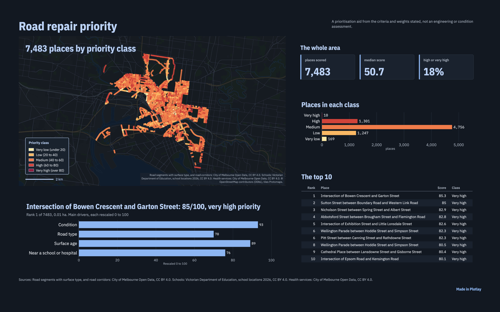

# Melbourne road repairs: which come first

The City of Melbourne rates the condition of its road carriageway segments from 1 (failed) to 5 (good). Here, its 7,483 rated segments are scored 0 to 100 for repair priority from that published condition, the road type, the distance to a school or hospital and the age of the surface, with the weights stated. The top 50 get a repair each, priced from published council asset plan rates. **Live version, with the cockpit board and the method:** [getplotlay.com/showcase/melbourne-road-repairs](https://www.getplotlay.com/showcase/melbourne-road-repairs/)



**Ten segments score 80 or more.** First is the intersection of Bowen Crescent and Garton Street in Carlton North (85.3): condition 1.3, a council major road, a surface 37 years old, 144 m from a school or hospital. Sutton Street in North Melbourne (85.0) and Nicholson Street between Spring Street and Albert Street (82.9) follow. With condition alone, 37 of the top 50 change.

The 50 repairs come to 22 reconstructions and 28 resurfacings over 28,823 m², A$1.52 million at the rates (A$2.24 million with the estimate's allowances and GST, a range of A$1.95 to 2.87 million). Indicative only.

Everything was made in [Plotlay](https://www.getplotlay.com): data layers of the segments and of schools and hospitals, the priority score on the Analyse tab, repairs raised from the top places, priced in Estimates, and the cockpit board.

[](https://app.plotlay.io/?example=melbourne-road-repairs&as=client)

## Read this first

- **A prioritisation aid with stated weights, not an engineering or condition assessment.** The weights (condition 50, road type 20, a school or hospital near 15, surface age 15) are a choice. Move them and the order changes; the notebook shows by how much.
- **The condition ratings are the council's**, mostly evaluated on 28 February 2026, as published. Only 88 of 1,424 arterial segments are rated and tram formations are not, so arterial roads are under-represented.
- **Road type** comes from the council's road corridors, joined by the segment's description (7,377 segments) or by the corridor its middle stands in (93); 13 have none and count as council minor.
- **Costs are indicative**: typical published rates, not quotes. Resurfacing at A$26 a m² and reconstruction at A$96 a m² (Knox City Council's road asset plan, 2019) are mid points of ranges; real costs depend on the site, traffic management and the market.
- **The building, roof and gutter inspection is a made-up sample** (`data/sample_inspection.csv`), placed where no such buildings stand. No council publishes these openly. It shows the workflow, not real buildings.

## What's here

| Folder | What |
|---|---|
| [`data/`](data) | `road_segments.csv`: each segment with its condition, road type, surface, dates, area, distance to a school or hospital, surface age, its score, class, rank and the four rescaled drivers. `schools_and_hospitals.csv`: the 87 places. `repairs.csv`: the 50 road repairs and the 12 sample ones, with quantities and costs. `method.json`: the criteria, weights, ranges and classes as Plotlay kept them. `sample_inspection.csv`: the made-up sample. `numbers.json`: every number above. |
| [`python/`](python) | A narrated notebook ([`melbourne_road_repairs.ipynb`](python/melbourne_road_repairs.ipynb)) that works the scores out again, checks them against Plotlay's, tries condition alone and sums the repairs |
| [`powerbi/`](powerbi) | A Power BI Project (`.pbip`): the segments by priority class, the drivers and the repairs. See [`powerbi/OPEN-ME.md`](powerbi/OPEN-ME.md) |
| [`visuals/`](visuals) | The cockpit board and map pictures, made in Plotlay |

### Run the notebook

```
python3 -m venv .venv
.venv/bin/pip install -r python/requirements.txt
cd python && ../.venv/bin/jupyter lab melbourne_road_repairs.ipynb
```

## Power BI

`powerbi/MelbourneRoadRepairs.pbip` opens in Power BI Desktop for Windows and reads `data/` from this repo on GitHub (or from a local copy: change the `DataFolder` parameter). Three pages: **Priority** (the 1,311 High and Very high segments on a Shape Map, the segments in each class and the 10 highest, with a road type slicer), **Drivers and repairs** (the four drivers of a segment picked and averaged by class, the 50 road repairs by treatment at indicative costs, and the made-up sample inspection) and **Every segment** (all 7,483 on Azure Maps). The outlines and a point in each segment are in `data/geometry/` (`road_segments.topojson`, `road_segment_centres.csv`). `powerbi/OPEN-ME.md` says how to open it and which numbers to expect after Refresh.

## How it was made

1. **Road segments**: the council's "Road segments with surface type" (61,424 polygons), the 7,483 road carriageways with a condition rating, each with its road type from the road corridors layer.
2. **Schools and hospitals**: the Victorian Department of Education's school locations for 2026 in and around the city (76), and the 11 health services in the council's landmarks.
3. **The score**: each criterion rescaled from 0 to 1 (condition between 1 and 5, lower raises the priority; road type arterial 100, council major 70, council minor 40, private 10; distance between 0 and 600 m, closer raises it; surface age between its 5th and 95th percentile), then the weighted mean, 0 to 100, in five classes of 20.
4. **Repairs**: one for each of the top 50 by its condition (reconstruction up to 1.75, resurfacing up to 2.5, patching above), counted in m² of the segment and priced from Plotlay's price book.

## Sources and licences

- Road segments with surface type, and road corridors: City of Melbourne Open Data, [CC BY 4.0](https://creativecommons.org/licenses/by/4.0/), updated 10 September 2026.
- School locations 2026: Victorian Department of Education, DataVic, CC BY 4.0.
- Landmarks and places of interest (health services): City of Melbourne Open Data, CC BY 4.0.
- Unit rates: Knox City Council Road Asset Management Plan (2019), Knox Footpath Asset Management Plan (2016), Wodonga Road Asset Management Plan 2026 to 2035, Warrnambool Pathway Asset Management Plan (2017).

The data in `data/` is CC BY 4.0 (`LICENSE-DATA`); please credit "Melbourne road repairs: Plotlay (getplotlay.com), from City of Melbourne and Victorian Department of Education open data". The notebook is MIT (`LICENSE`). This is independent work using open data, not endorsed by the City of Melbourne.
